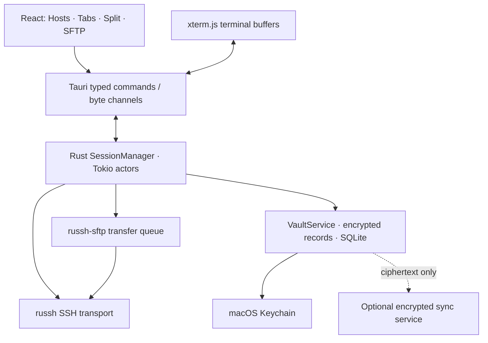

# 독립 SSH 클라이언트 아키텍처

**0.2 구현:** `vault.rs`의 SQLite 암호문 + Keychain, `files.rs`의 별도 SSH 채널 SFTP, `FilesPane.tsx`, `TerminalPane.tsx`, `components.tsx`를 추가했다. [현재 구현과 검증](https://github.com/Polar-Little-Lab/polarsh/blob/main/docs/release-0.2.md). Vault는 현재 workspace 전체를 하나의 AEAD payload로 저장하며 아래의 개별 레코드 모델은 후속 설계다.

상태: 2026-10-24 목표 설계. 후속 요청으로 SSH 개발 미리보기를 구현했다. 아래 SQLite/Vault/SFTP/Sync 등은 아직 목표 구조이며 [현재 구현](development-status.md)과 구별한다. Termius보다 빠르다는 측정 결과는 아직 없다.

## 선택 스택

Tauri 2 + React/TypeScript + Rust/Tokio + xterm.js + SQLite + macOS Keychain을 채택한다. macOS의 시스템 WebView를 활용하고 네트워크·비밀·저장은 Rust에 둔다. React는 화면 구성, xterm은 터미널 에뮬레이션만 담당한다. xterm.js 자체가 SSH 엔진은 아니다.

| 계층 | 책임 / 선택 근거 | 주의점 |
|---|---|---|
| Tauri 2 | 작은 배포 크기와 native Rust 경계, 명시적 IPC | WebKit 입력/렌더링·배포 서명 검증 필요 |
| React + TypeScript | hosts/tree, tabs/split, transfer UI | 터미널 byte stream을 React state로 매번 복사하지 않음 |
| xterm.js | VT/ANSI 표시, fit/search addon | WebGL 사용 가능성은 WKWebView에서 실측; fallback 필요 |
| Rust + Tokio | 비동기 SSH/SFTP, 상태 전이, 취소 | actor당 bounded queue; blocking 작업 분리 |
| SQLite | schema migration, 트랜잭션, 메타데이터 | 일반 SQLite는 암호화 저장소가 아님 |
| macOS Keychain | vault master key 보호 | WebView에는 key bytes 반환 금지; 잠금/복구 명시 |

[Tauri IPC](https://v2.tauri.app/concept/inter-process-communication/) 및 [xterm 보안 지침](https://xtermjs.org/docs/guides/security/)을 참고했다. 2026-10-24 registry 확인 시 Tauri 2.12.5의 Rust 최소 요구는 1.90이다. Rust 1.99.1을 설치하고 lockfile로 검증 조합을 고정했다.

## SSH/SFTP 라이브러리 비교와 결정

버전·갱신일·라이선스는 registry 확인 로그 (`../logs/library-metadata.json` · 이전 개발 환경의 로컬 기록, 저장소 미포함) 기준이다. README의 main과 published crate 내용이 다를 수 있으므로 구현 시작 시 버전별 API/crypto backend를 다시 고정한다.

| 후보 | 유지보수 관찰 | 지원·장점 | 비용·보안·라이선스 |
|---|---|---|---|
| russh 0.64.1 + russh-sftp 3.0.1 | 각각 2026-10-05 / 09-28 갱신 | Tokio async, PTY/channels, password/key/keyboard-interactive, forwarding; SFTP v3 | 둘 다 Apache-2.0. Rust지만 crypto/native 의존성과 unsafe 영역도 검토. 독립 보안 감사 완료로 간주하지 않음 |
| ssh2 0.9.6 / libssh2 | 2026-06-30 갱신 | SSH client, agent, SFTP, 안정된 C 기반 API | Rust wrapper MIT OR Apache-2.0; libssh2 BSD 계열 별도. C/FFI/OpenSSL 패치 책임, blocking 또는 nonblocking event 연동 필요 |
| openssh crate 0.11.6 | 2025-12-03 갱신 | OS OpenSSH 설정·ControlMaster 재사용 | MIT OR Apache-2.0; unix 중심, remote command API에 적합. 대화형 password/MFA/PTY UI 제어에는 별도 설계 |
| OS ssh/sftp + PTY 직접 실행 | macOS 보안 업데이트에 종속 | 높은 OpenSSH 호환성, agent/ProxyJump 활용 | 외부 프로세스 lifecycle·프롬프트 처리·파일 전송 구조화 어려움; 셸 문자열 조립 금지 |

**결정:** 기본 엔진은 `russh + russh-sftp`. Tokio 기반 다중 세션과 취소·재연결 상태 관리가 앱 구조에 잘 맞는다. `Transport` 추상화로 엔진 결합을 줄이고, 호환성 실패가 확인될 때만 OpenSSH adapter를 검토한다. ssh2를 동시에 넣어 복잡도를 키우지 않는다.

russh-sftp README에는 unit tests 항목이 미완료로 남아 있어 자체 OpenSSH 통합 테스트를 release gate로 둔다. README의 처리량 숫자를 이 Mac 또는 새 앱의 성능으로 인용하지 않는다. FIDO2·PQC·certificate·agent 동작은 이름만 보고 지원을 보장하지 않고 선택 버전의 통합 테스트로 결정한다.

근거: [russh](https://github.com/Eugeny/russh), [russh-sftp](https://github.com/AspectUnk/russh-sftp), [ssh2 API](https://docs.rs/ssh2/latest/ssh2/), [openssh API](https://docs.rs/openssh/latest/openssh/).

## 세션 및 IPC 계약

세션 상태는 `Disconnected → Resolving → Connecting → HostKeyCheck → Authenticating → Connected → Reconnecting/Closing`으로 모델링한다. `HostKeyChanged`, `AuthFailed`, `Cancelled`는 별도 종료/대기 원인이다. reconnect는 새 SSH 연결이며 끊긴 원격 shell을 되살리지 않는다. shell 지속성은 향후 tmux 등 별도 기능이다.

UI command는 `connect(host_id)`, `send_input(session_id, bytes)`, `resize(session_id, rows, cols)`, `disconnect(session_id)`, `start_transfer(...)`, `cancel_transfer(id)`와 같은 제한된 타입으로 설계한다. session ID에 window ownership을 검증하고 임의 파일 경로·임의 shell 실행을 노출하지 않는다. 출력은 session별 순서 번호와 bounded binary channel로 전송하고 xterm 소비 완료를 기반으로 흐름을 조절한다. 16~32 KiB 또는 짧은 시간 단위 batch 크기는 초기 가설이며 측정 후 조정한다.

각 session actor는 소켓·channel·heartbeat·취소 토큰을 소유한다. 느린 세션이나 SFTP가 다른 세션의 입력을 막지 않도록 별도 queue를 둔다. 숨겨진 탭은 렌더링 빈도를 줄이되 수신 버퍼 상한을 지킨다. 1 GiB 출력도 전체 문자열을 메모리에 쌓지 않는다.

## 신뢰·비밀·저장

- 서버 host key는 SHA-256 fingerprint를 표시하고 최초 연결 동의를 기록한다. 변경 시 차단하며 자동 신뢰하지 않는다. 각 jump hop을 독립 검증한다.
- 약한 알고리즘은 기본 비활성. agent forwarding은 호스트별 명시적 선택. 터널은 기본 127.0.0.1에 바인딩한다.
- `VaultService`는 OS CSPRNG master key, 검증된 AEAD(XChaCha20-Poly1305 후보), nonce 유일성, vault/record/version AAD를 사용한다. 자체 암호 알고리즘을 만들지 않는다.
- master key는 macOS Keychain, SQLite에는 암호문 레코드와 최소 메타데이터만 저장한다. 호스트명/태그도 민감하므로 암호화 payload에 포함하고 잠금 해제 후 메모리 인덱스를 만든다. SQLite WAL/backup에도 평문 비밀을 기록하지 않는다.
- 테이블 초안: `vaults`, `encrypted_records(id,vault_id,kind,nonce,ciphertext,revision)`, `schema_migrations`, `sync_outbox`. payload에는 host/group/credential-ref/snippet/workspace/known-host/transfer-rule를 담는다. Keychain과 DB 사이 부분 실패를 복구할 versioned transaction 절차가 필요하다.
- 원격 출력은 신뢰하지 않는다. HTML 삽입 금지, 링크 scheme 제한, OSC52 clipboard는 명시적 허용, 원격 페이지/CDN script 로드 금지. CSP와 최소 Tauri capability를 적용한다.
- 키 export는 별도 명시적 작업이며 일반 host export에 비밀을 포함하지 않는다. password/key를 telemetry·오류 로그에 쓰지 않는다. 메모리 zeroization은 가능한 Rust 버퍼에 적용하되 완전한 무잔류 보장이라고 표현하지 않는다.

## SFTP·생산성·서비스 확장

SFTP는 bounded 다중 전송 queue, byte progress, 취소, resume 검증, 임시 목적 파일/원자적 rename을 설계한다. 서버가 atomic extension을 지원하지 않을 때 fallback과 overwrite 확인을 명확히 한다. symlink를 맹목적으로 따라 재귀 탐색/삭제하지 않는다.

로그는 기본 off 또는 명시적 opt-in으로 하고 출력만 기록해도 비밀이 포함될 수 있음을 UI에 설명한다. 암호화 chunk·보존 기간·삭제를 제공하고 전문 검색은 unlock 시 메모리에서 수행한다. SQLite plaintext FTS에 복호화 로그를 넣지 않는다.

Broadcast는 대상 세션이 항상 보이게 하고 인증 prompt에는 전달하지 않는다. snippet과 AI 추천은 paste와 execute를 분리한다. reconnect·workspace restore 시 명령 자동 replay는 기본 금지한다.

Sync는 서버가 ciphertext만 저장하는 모델이다. device enrollment·기기 폐기·키 회전·recovery·tombstone·동시 수정 충돌·rollback 탐지를 먼저 설계한다. TLS만으로 E2EE를 주장하지 않는다. 충돌한 host/key를 자동 last-write-wins로 덮어쓰지 않고 revision conflict를 드러낸다. 협업은 별도 key distribution/권한 모델과 relay 서비스가 필요하다. 탈퇴자가 이미 복호화한 비밀을 회수할 수 있다고 약속하지 않는다.

AI는 사용자 입력 또는 선택한 컨텍스트만 전송하는 opt-in adapter로 분리한다. 전체 terminal/credentials를 자동 업로드하지 않는다. 모델 출력은 비신뢰 제안이며 자동 실행하지 않는다.

## 성능 목표와 검증 방법

아래는 **제안 목표**이며 달성 수치가 아니다. 동일 Mac·release build·동일 server/RTT·동일 출력·동일 scrollback에서 Termius baseline을 별도 측정한다.

| 지표 | 초기 목표 / 비교 방법 |
|---|---|
| cold / warm startup | cold p95 < 1.5s, warm p95 < 0.5s; 각 30회, 사용 가능 시점 정의 |
| 메모리 | idle 전체 process-tree RSS < 180 MiB; 10 idle sessions < 350 MiB; WebView helper 포함 |
| CPU | 10 idle sessions에서 평균 < 한 코어의 2%; 60초 측정, OS background 통제 |
| UI 반응 | local input-to-render p95 < 30ms, 대량 출력 중 타 탭 입력 p95 < 50ms |
| 안정성 | 50 sessions/8시간, 100 connect-disconnect 반복 후 지속 RSS 증가 없음 |
| 네트워크 복원력 | loss/timeout/DNS failure/sleep-wake와 host-key 변경에서 상태·취소가 일관됨 |
| SFTP | native OpenSSH SFTP 대비 throughput·CPU 비교; 취소 후 파일 손상/handle 누수 없음 |

목표 초과 시 렌더링 batch, 숨긴 탭, 버퍼 상한, SFTP 동시성 순으로 profile한다. Tauri 선택만으로 절대적인 성능 우위를 보장하지 않는다.
