# pTerm 사용 가이드 · Frost

> 제품명이 Polarsh에서 pTerm으로 변경되었습니다. 아래 스크린샷과 기존 다운로드 파일은 이름 변경 전 버전을 기준으로 합니다.

로컬 개발부터 SSH 서버 관리까지, 하나의 터미널에서 작업하세요.

**대상 버전: 1.1.0 · macOS Apple Silicon · 기준 테마: Frost · 작성일: 2026-10-25**

> 아래 11장은 **macOS에서 실행한 Polarsh 네이티브 앱**을 직접 조작해 촬영했습니다. 배포 버전 1.0.0과 동일한 UI·기능 소스를 사용하고, 사용자 데이터 보호를 위해 촬영용 앱의 저장소 식별자와 앱 번들 이름만 분리했습니다. 모든 화면은 Frost 테마입니다. SSH·Bastion은 이 Mac의 로컬 실습 서버에 실제 연결한 화면이며 외부 운영 서버가 아닙니다. [촬영·검증 기록](guide-capture-verification.md)에서 조건을 확인할 수 있습니다.

## 가이드와 같은 화면으로 시작하기

이 가이드는 밝은 **Frost** 테마를 기준으로 설명합니다. 옅은 청회색 배경, 흰색 카드와 파란색 선택 표시로 작업 영역을 구분합니다. 호스트 관리부터 터미널 분할, SFTP까지 아래 스크린샷은 모두 Frost로 촬영했습니다.

앱을 연 뒤 `⌘ K` → **테마 변경** → **Frost · 차가운 아이스 화이트**를 선택하고 **완료**를 누르세요. 왼쪽 탐색 패널 아래 **테마**에서도 바꿀 수 있습니다. 이 설정은 다음 실행에도 유지됩니다.

다른 테마에서도 버튼 위치와 사용 방법은 같습니다. Frost는 이 문서의 기준이며 앱의 기본 테마 설정을 바꾸지는 않습니다.

## 1. 설치하고 로컬 작업 시작하기

1. [1.0.0 다운로드 페이지](https://github.com/Polar-Little-Lab/pTerm/releases/tag/v1.0.0)에서 `pTerm-1.0.0-macos-arm64.zip`을 받습니다.
2. ZIP을 풀고 `pTerm.app`을 응용 프로그램 폴더로 옮깁니다.
3. pTerm을 실행합니다. 새 로컬 터미널 하나가 열립니다.
4. `pwd`를 입력하고 Enter를 눌러 현재 폴더를 확인해 보세요.

현재 저장소는 비공개이므로 다운로드하려면 접근 권한이 있는 GitHub 계정으로 로그인해야 합니다. Intel Mac용 실행 파일은 아직 제공하지 않습니다.

### Apple이 앱을 확인할 수 없다는 경고가 나오면

pTerm 1.0.0은 Apple Developer ID 서명·공증을 받지 않아 첫 실행이 차단될 수 있습니다. 공식 GitHub 릴리스에서 받은 파일인지 확인한 뒤 다음 순서로 진행하세요.

1. 경고창에서 **완료**를 누릅니다.
2. **시스템 설정 → 개인정보 보호 및 보안**을 엽니다.
3. 아래쪽 보안 영역에서 pTerm 차단 안내 옆 **그래도 열기**를 누릅니다.
4. macOS가 요청하는 인증을 진행하고 **열기**를 선택합니다.

해당 앱에 대한 예외가 등록되면 이후에는 일반적으로 더블클릭으로 열 수 있습니다. Mac 전체의 보안 기능을 끌 필요는 없습니다. [Apple 공식 절차](https://support.apple.com/ko-kr/102445)

버튼이 보이지 않는다면 [첫 실행 문제 해결 가이드](macos-first-launch.md)를 확인하세요. 첫 실행 승인은 SSH 비밀번호 인증과 별개입니다.

### 폴더를 지정해서 열기

`⌘ N`을 누르거나 빠른 전환에서 **새 로컬 터미널**을 선택합니다. 시작 폴더를 입력하거나 **찾기**로 선택하고 **로컬 터미널 열기**를 누르세요. 입력하는 폴더는 실제로 존재해야 합니다.

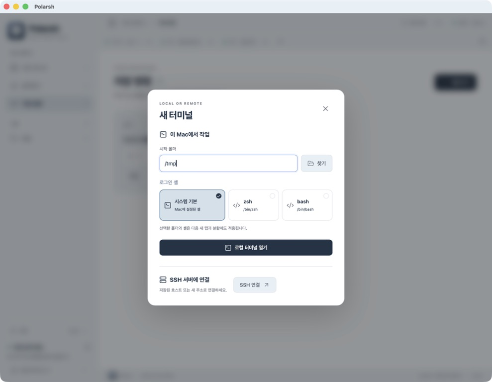

*시작 폴더와 로그인 셸을 한 번에 선택합니다. 촬영에서는 임시 작업 폴더 `/tmp`를 사용했습니다. 실제 작업할 때는 본인의 프로젝트 폴더를 선택하세요.*

셸을 따로 지정할 이유가 없다면 **시스템 기본**으로 두세요. 선택한 폴더와 셸은 다음 새 탭과 분할에도 적용됩니다. 새 탭만 바로 열려면 마지막 탭 옆 **+** 또는 `⌘ T`를 사용합니다.

로컬 터미널을 여는 데 저장된 항목의 잠금 해제는 필요하지 않습니다.

## 2. 자주 쓰는 서버 정리하기

왼쪽 탐색 패널에서 **모든 호스트 → 호스트 추가**를 선택합니다. 저장된 항목이 잠겨 있다면 먼저 **저장된 항목 열기**를 눌러 macOS 키체인 접근을 승인합니다.

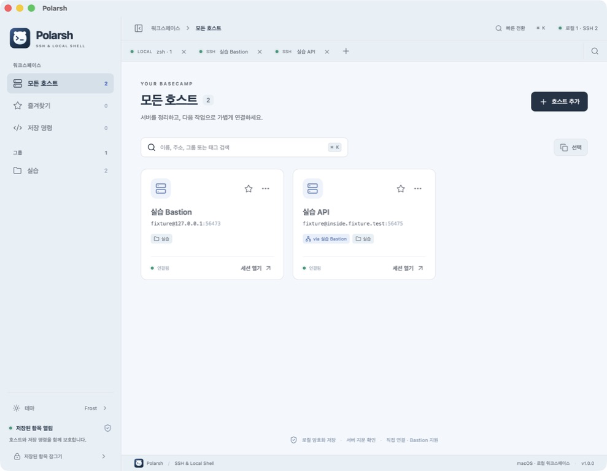

*로컬 터미널과 SSH 세션이 열린 실제 화면입니다. 왼쪽에는 워크스페이스·그룹·저장 상태가 있고, 새 터미널과 빠른 전환은 상단 탭 줄에서 사용합니다. 두 실습 호스트 모두 연결된 상태입니다.*

- **그룹:** 개발, 스테이징, 운영처럼 환경별로 나눠 보세요. 호스트에 그룹을 입력하면 왼쪽 목록에 표시됩니다.
- **태그:** `api, web, database`처럼 용도를 쉼표로 구분해 입력합니다.
- **즐겨찾기:** 자주 쓰는 호스트의 별을 누릅니다.
- **검색:** 이름, 주소, 그룹, 태그로 찾습니다.
- **여러 항목 정리:** **선택**을 누르고 호스트를 고른 뒤 그룹 이동 또는 선택 삭제를 사용합니다. 삭제 확인에서 대상을 다시 확인하세요.

연결 정보를 바꾸려면 해당 카드의 **…** 편집 버튼을 사용하세요.

## 3. 첫 SSH 연결 만들기

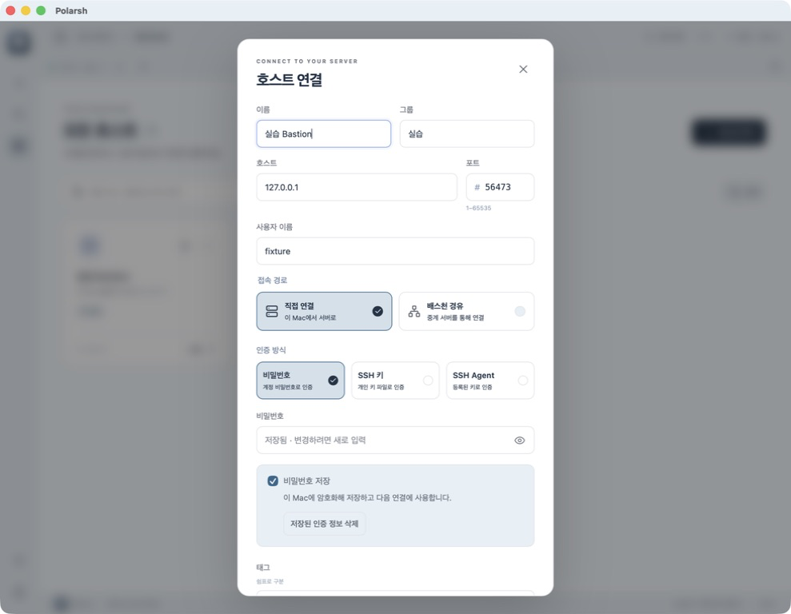

*저장된 실습 호스트의 접속 설정과 인증 상태를 편집하는 화면입니다. 입력 폼이 길면 아래로 스크롤해 저장·연결 버튼을 찾으세요.*

| 항목 | 입력할 내용 | 예시 |
| --- | --- | --- |
| 이름 | 내가 알아보기 쉬운 이름 | Web · 개발 |
| 호스트 | 서버의 DNS 이름 또는 IP 주소 | web.dev.example.test |
| 포트 | 서버에서 사용하는 SSH 포트 | 22 |
| 사용자 이름 | 서버에 존재하는 로그인 계정 | developer |
| 접속 경로 | 직접 연결 또는 배스천 경유 | 직접 연결 |
| 인증 방식 | 서버에서 허용한 인증 방식 | 비밀번호 / SSH 키 / SSH Agent |

표의 `.test` 주소는 설명용입니다. 캡처의 `127.0.0.1:56473`와 `inside.fixture.test:56475`는 촬영 중 실행한 로컬 실습 서버에만 유효합니다. 본인의 서버 주소·포트·계정으로 바꾸세요.

### 인증 방식 고르기

| 방식 | 사용 방법 |
| --- | --- |
| 비밀번호 | 해당 서버 계정의 비밀번호를 입력합니다. |
| SSH 키 | 개인 키 파일의 **절대 경로**를 입력합니다. 암호화된 키라면 연결할 때 키 암호를 입력합니다. |
| SSH Agent | 실행 중인 SSH Agent에 등록된 키를 사용합니다. pTerm에서 Agent 소켓에 접근할 수 있어야 합니다. |

**비밀번호 저장** 또는 **키 암호 저장**을 선택하면 호스트와 인증 정보를 이 Mac에 암호화해 보관합니다. **저장**은 설정을 저장하고, **연결**은 설정을 저장한 뒤 접속합니다. 선택하지 않은 인증 정보는 이번 연결에만 사용합니다.

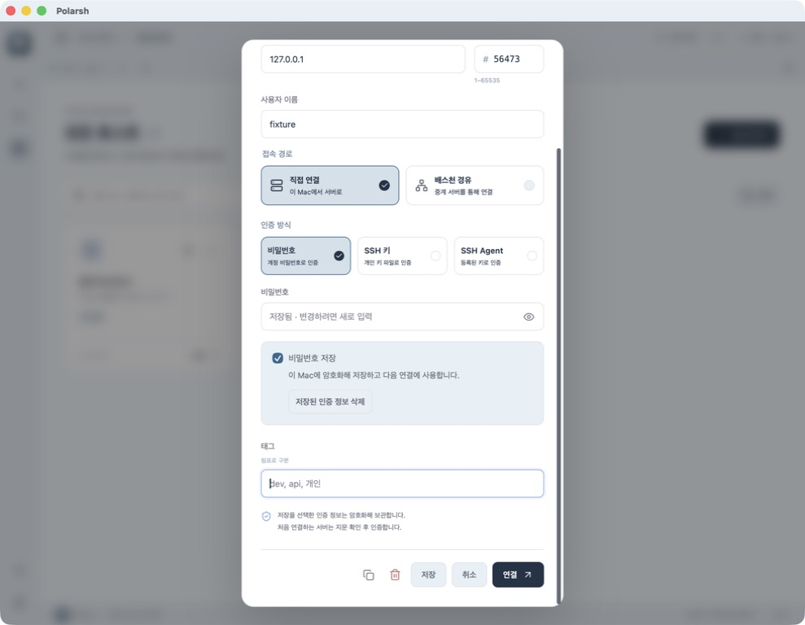

*호스트 편집 창을 아래로 스크롤한 화면입니다. 저장 옵션과 태그를 여백으로 구분하며, 실제 비밀번호는 표시하지 않습니다.*

다음 연결에서는 저장된 인증 정보를 자동으로 사용합니다. 앱을 다시 실행했다면 먼저 **저장된 항목 열기**로 암호화 저장소를 열어 주세요. 로컬 터미널은 이 과정 없이 사용할 수 있습니다.

- 인증 정보를 바꾸려면 호스트 편집에서 새 비밀번호·키 암호를 입력하고 저장합니다. 입력란이 비어 있고 **저장됨**으로 표시되면 기존 값을 유지합니다.
- **저장된 인증 정보 삭제**는 인증 정보만 삭제합니다. 저장 옵션을 해제한 뒤 **저장**해도 삭제됩니다.
- 호스트를 삭제하면 해당 인증 정보도 함께 삭제됩니다. 호스트 복제 시 인증 정보는 복사하지 않습니다.
- 주소·포트·사용자·인증 방식·키 파일·Bastion 경로를 바꾸면 기존 인증 정보를 재사용하지 않습니다. 새 설정에 맞는 값을 입력해 주세요.
- 저장된 인증 정보가 거부되면 다시 입력할 수 있습니다. 저장 옵션이 켜진 상태에서 인증에 성공하면 새 값으로 교체됩니다.
- Bastion과 대상 서버는 각각의 인증 정보를 사용합니다.
- SSH 키는 **개인 키 파일 경로와 선택한 키 암호**를 저장합니다. 개인 키 파일 자체는 앱에 복사하지 않으므로 해당 파일을 유지해야 합니다. SSH Agent는 Agent에 등록된 키를 사용합니다.

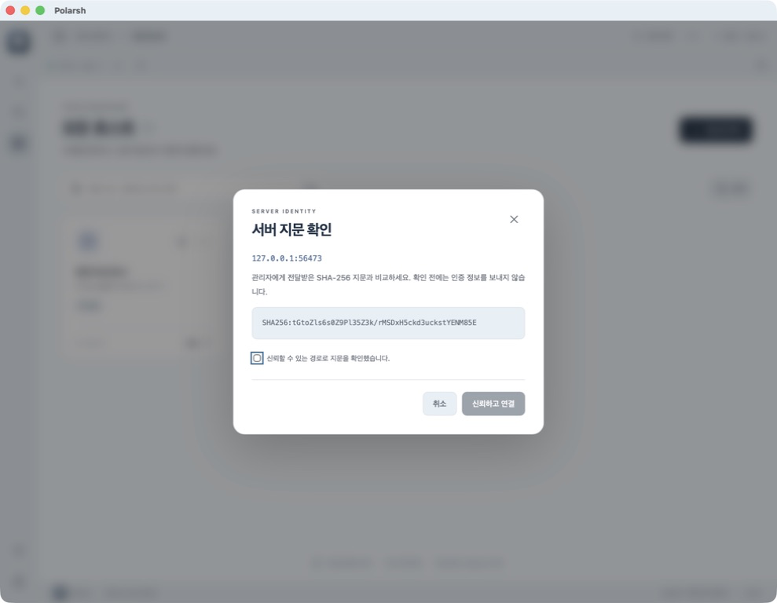

*처음 연결한 실습 서버의 지문 확인 화면. 서버 프로세스가 출력한 지문과 대조한 뒤 연결했습니다.*

처음 접속하는 서버는 지문 확인 창을 표시합니다. 서버 관리자가 별도 경로로 전달한 **SHA-256 지문**과 비교한 뒤 신뢰하고 연결하세요. 저장된 서버 키와 달라지면 연결을 차단하므로, 먼저 관리자에게 변경 이유를 확인하세요.

## 4. Bastion을 통해 내부 서버에 연결하기

Bastion은 내부망 서버로 들어가는 중계 서버입니다. 두 서버를 각각 등록한 뒤 연결 관계를 지정합니다.

1. Bastion 서버를 **직접 연결**로 등록하고 저장합니다.
2. 내부 서버를 새 호스트로 등록합니다. 호스트에는 **Bastion에서 접근 가능한 내부 주소**를 입력합니다.
3. 접속 경로에서 **배스천 경유**를 고릅니다.
4. 저장해 둔 Bastion 호스트를 선택합니다.
5. 경로가 **이 Mac → Bastion → 내부 서버**인지 확인하고 저장 또는 연결합니다.

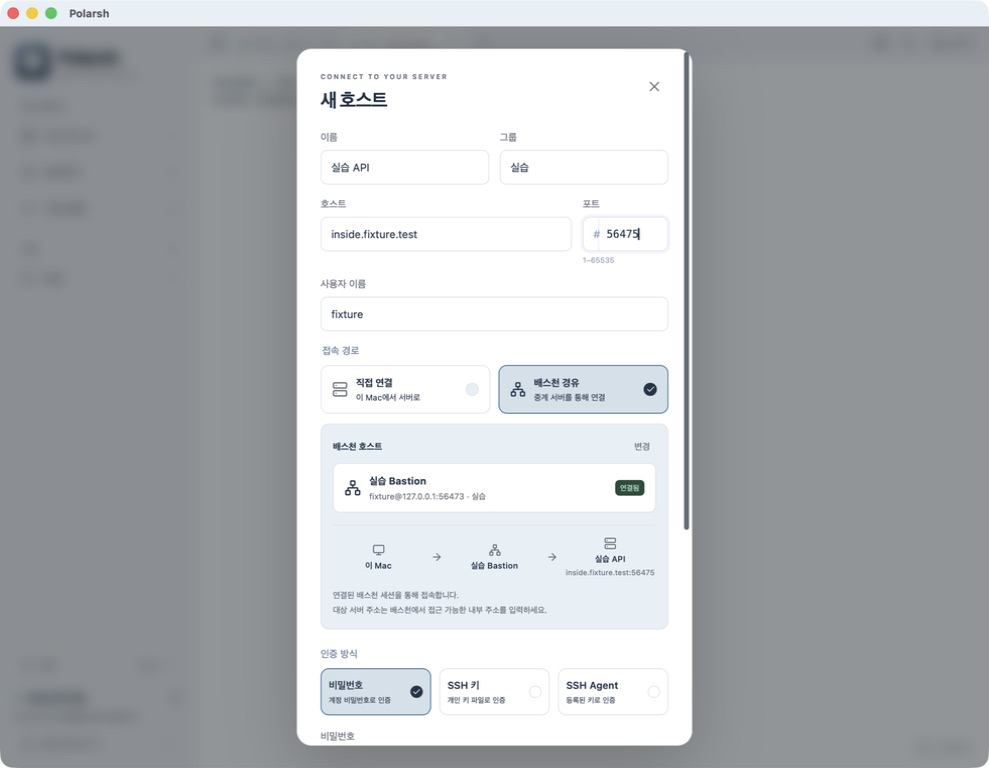

*호스트 등록 창을 아래로 스크롤해 본 접속 경로입니다. 이미 연결된 Bastion을 통해 내부 대상 서버에 연결하도록 지정했습니다. 두 서버 모두 촬영용 로컬 프로세스입니다.*

Bastion을 미리 연결해 둘 필요는 없습니다. 연결 시 필요한 경유 서버부터 순서대로 인증합니다. 각 서버의 계정·키·지문은 서로 다를 수 있습니다. 내부 서버에 접속할 수 없다면 Bastion 자체의 연결 상태와 Bastion에서 대상 서버로 접근 가능한지부터 확인하세요.

## 5. 탭과 분할로 작업 공간 구성하기

**탭**은 작업 묶음이고, **분할 영역**은 같은 탭 안에서 동시에 보는 터미널입니다. 한 탭에는 최대 4개 영역을 배치할 수 있습니다.

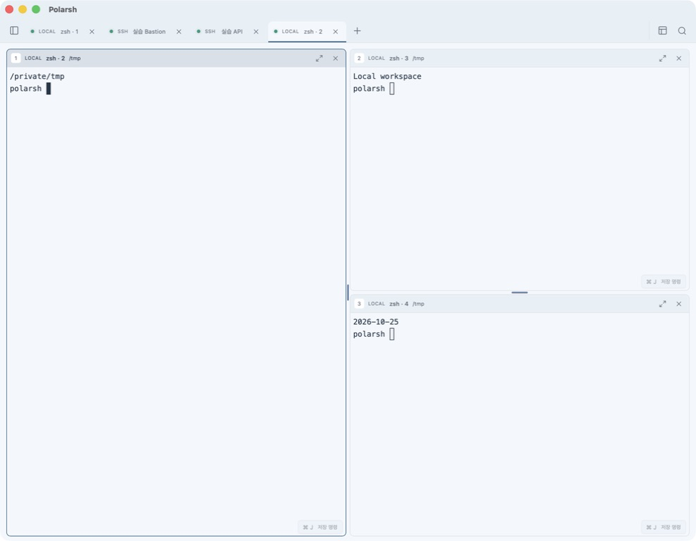

*실제로 실행 중인 로컬 zsh 세션 세 개를 왼쪽 크게 · 3분할로 배치했습니다. `pwd`, `printf`, `date`를 직접 실행한 출력과 저장 명령 버튼, 크기 조절 구분선이 표시됩니다.*

### 새 터미널을 분할로 추가하기

분할 기준이 될 터미널을 클릭한 뒤 `⌘ D`로 오른쪽에, `⌘ ⇧ D`로 아래에 새 로컬 터미널을 엽니다. 탭 줄 오른쪽 **터미널 배치** 메뉴에서도 같은 작업을 할 수 있습니다.

영역 수가 충분하면 배치 메뉴에서 좌우·상하 2분할, 왼쪽 또는 위쪽이 큰 3분할, 격자 4분할을 선택할 수 있습니다. 필요한 영역 수보다 적으면 해당 배치가 비활성화됩니다.

### 기존 터미널을 드래그로 합치기

1. 옮길 탭을 잡고 대상 터미널 쪽으로 드래그합니다.
2. 다른 탭으로 옮기려면 대상 탭 위에 잠시 머물러 해당 내용을 표시합니다.
3. 대상 영역의 가장자리로 이동해 분할 미리보기를 확인합니다.
4. 원하는 배치가 보일 때 놓습니다. 전체 작업 영역의 가장자리와 개별 영역의 가장자리는 결과가 다를 수 있으므로 미리보기를 기준으로 놓으세요.

분할을 다시 독립 탭으로 만들려면 **분할 영역의 제목 줄**을 탭 줄의 삽입 위치로 드래그합니다. 탭 자체를 끌면 그 탭에 묶인 영역을 함께 이동할 수 있습니다.

### 크기와 집중 영역 바꾸기

영역 사이 구분선을 드래그해 크기를 조절합니다. `⌘ ⌃ 방향키`로도 조절할 수 있습니다. 한 영역에 집중하려면 해당 영역에서 `⌘ ⇧ Enter`를 누르고, 같은 단축키로 원래 배치로 돌아옵니다.

영역을 닫으면 해당 세션도 종료됩니다. 단순히 배치에서 빼고 계속 사용하려면 닫기 대신 탭 줄로 분리하세요.

## 6. 빠른 전환으로 바로 이동하기

`⌘ K`를 눌러 열린 세션, 저장된 호스트, 새 로컬 터미널, 테마 변경을 찾습니다. 검색 후 방향키로 고르고 Enter를 누르세요.

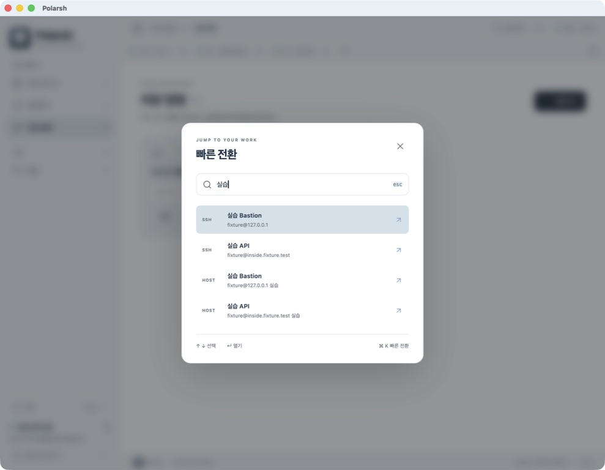

*실습이라는 검색어로 열린 SSH 세션을 찾은 실제 화면입니다. 검색어를 비우면 새 로컬 터미널·테마 변경 등 다른 작업도 찾을 수 있습니다. 결과가 많으면 목록을 스크롤하세요.*

열린 세션을 고르면 그 세션으로 이동합니다. 저장된 호스트를 고르면 연결 절차를 시작하며 필요한 인증을 요청할 수 있습니다. 주소나 계정을 수정하려면 **모든 호스트**에서 편집하세요.

## 7. SFTP로 파일 주고받기

SSH 연결이 완료된 터미널에서 탭 줄의 **SFTP** 버튼을 누릅니다. 로컬 터미널에는 SFTP가 표시되지 않으며, 연결이 끊긴 SSH 세션에서는 사용할 수 없습니다.

1. 왼쪽에서 로컬 폴더, 오른쪽에서 원격 대상 폴더를 엽니다.
2. 보낼 파일의 체크박스를 선택합니다. 여러 파일을 함께 선택할 수 있습니다.
3. 로컬 → 서버는 **업로드**, 서버 → 로컬은 **다운로드**를 누릅니다.
4. 전송 상태를 확인하고 필요하면 진행 중 전송을 취소합니다.
5. 작업을 마치면 **터미널로 돌아가기**를 누릅니다.

경로 입력란과 상위 폴더 버튼으로 이동할 수 있고, **원격 폴더 만들기**로 대상 폴더를 만들 수 있습니다. 목록이 달라졌다면 새로고침을 사용하세요.

1.0.0은 같은 이름의 파일을 덮어쓰지 않습니다. 폴더 전체·심볼릭 링크 전송과 중단된 전송 이어받기는 지원하지 않습니다. 동일한 이름이 있으면 이름이나 대상 폴더를 바꿔 전송하세요.

## 8. 반복 명령 저장해 사용하기

왼쪽 **저장 명령 → 명령 추가**에서 이름과 명령을 입력하고 저장합니다.

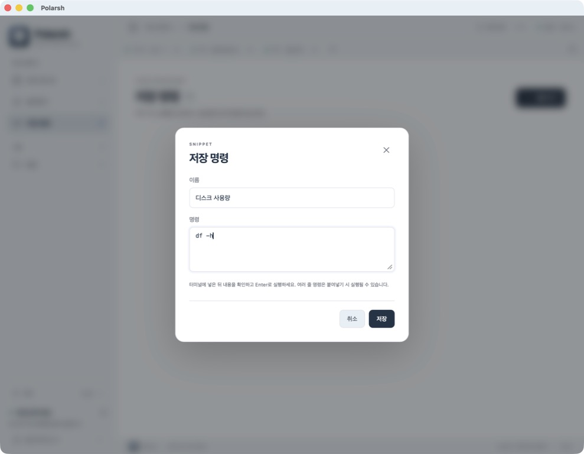

*알아보기 쉬운 이름으로 자주 쓰는 명령을 보관합니다.*

처음에는 `pwd`, `df -h`, `git status`처럼 결과를 확인하기 쉬운 명령을 등록해 보세요. Git 명령은 Git 저장소 폴더에서 사용합니다.

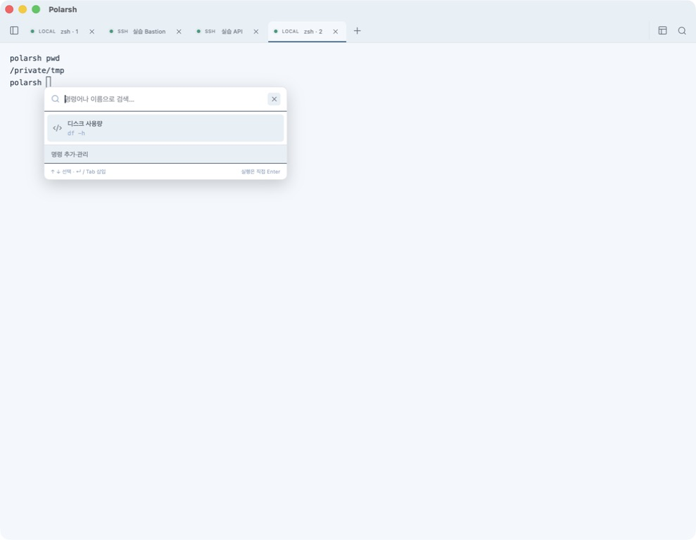

*등록한 디스크 사용량 명령을 실제 터미널에서 불러왔습니다. 별도 오른쪽 패널이 아니라 커서 근처의 선택 창으로 표시됩니다.*

터미널에 포커스를 둔 상태에서 `⌘ J`로 저장 명령 선택 창을 열고 검색합니다. 터미널 오른쪽 아래 **⌘ J 저장 명령** 버튼으로도 열 수 있습니다. 명령을 선택해 넣은 뒤 내용을 확인하고 Enter로 실행하세요. **여러 줄 명령은 붙여넣는 과정에서 실행될 수 있으므로** 확인 창에서 내용을 살펴보세요.

저장 명령은 호스트와 함께 암호화해 보관합니다. 저장된 항목이 잠겨 있으면 먼저 잠금을 해제해야 합니다. 명령을 입력할 때마다 자동으로 추천하는 기능과는 다르게, `⌘ J`로 직접 불러오는 방식입니다.

## 9. 테마 바꾸기

이 가이드와 같은 화면을 사용하려면 **Frost**를 선택하세요. 탐색 패널 아래 **테마**를 누르거나 `⌘ K` → **테마 변경**으로 선택 창을 엽니다.

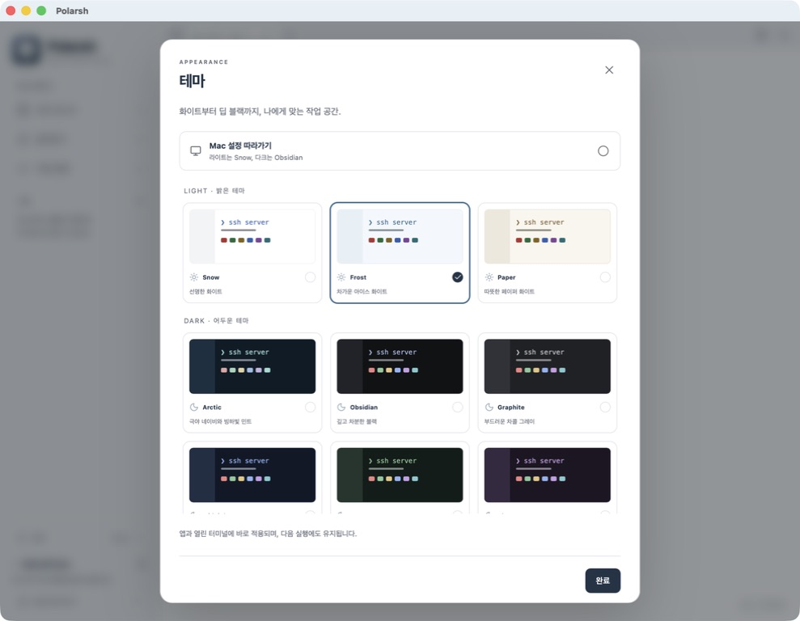

*Frost가 선택된 실제 테마 창. 파란 테두리와 체크 표시로 현재 선택을 확인합니다. 아래쪽 테마가 가려지면 목록을 스크롤하세요. 앱과 터미널의 색상이 함께 바뀝니다.*

| 분위기 | 테마 |
| --- | --- |
| 밝은 화면 | Snow, Frost, Paper |
| 검정·회색 중심 | Obsidian, Graphite |
| 색감이 있는 어두운 화면 | Midnight, Forest, Plum |
| pTerm의 북극 색감 | Arctic |

선택은 열린 터미널에 바로 적용되고 다음 실행에도 유지됩니다. **Mac 설정 따라가기**를 선택하면 밝은 모드에서는 Snow, 어두운 모드에서는 Obsidian을 사용합니다.

## 10. 이렇게 사용해 보세요

| 작업 | 구성 예시 |
| --- | --- |
| 로컬 개발 | 프로젝트 폴더에서 터미널을 열고, 오른쪽에 개발 서버용 셸을 분할합니다. 왼쪽에서는 Git과 테스트를 실행합니다. |
| 서버 점검 | 호스트를 개발·운영 그룹으로 나누고, 두 서버를 나란히 배치합니다. 현재 영역의 서버 이름을 확인한 뒤 명령을 실행합니다. |
| 내부망 운영 | Bastion과 내부 서버를 각각 저장하고 경유 연결을 지정합니다. 다음부터는 내부 서버 이름으로 빠른 전환에서 찾습니다. |
| 로그 가져오기 | SSH 연결 후 SFTP에서 로그 파일을 선택해 로컬 작업 폴더로 다운로드합니다. |

## 자주 쓰는 단축키

`⌘` Command · `⇧` Shift · `⌥` Option · `⌃` Control. 터미널 단축키는 대화상자가 닫혀 있고 해당 화면에 포커스가 있을 때 사용하세요.

| 단축키 | 동작 |
| --- | --- |
| `⌘ T` | 새 로컬 탭 |
| `⌘ N` | 폴더·셸을 선택하는 새 터미널 창 |
| `⌘ K` | 빠른 전환 |
| `⌘ B` | 탐색 패널 펼치기·접기 |
| `⌘ D` / `⌘ ⇧ D` | 오른쪽 / 아래에 새 로컬 터미널 |
| `⌘ ⌥ 방향키` | 분할 영역 간 포커스 이동 |
| `⌘ [` / `⌘ ]` | 이전 / 다음 분할 영역 |
| `⌘ ⌃ 방향키` | 분할 크기 조절 |
| `⌘ ⇧ Enter` | 현재 영역 확대·복귀 |
| `⌘ ←` / `⌘ →` | 이전 / 다음 탭 |
| `⌘ 1` … `⌘ 9` | 해당 순서의 탭 |
| `⌘ J` | 터미널에서 저장 명령 선택 |
| `⌘ W` | 현재 터미널 닫기 |

## 자주 묻는 질문

### 키체인 암호와 SSH 비밀번호는 다른가요?

네. macOS 키체인 승인은 **이 Mac에 저장된 호스트와 명령을 여는 과정**입니다. SSH 비밀번호나 키 암호는 **원격 서버에 인증하는 과정**입니다. 서로 다른 인증이므로 상황에 따라 각각 요청될 수 있습니다.

저장된 항목의 잠금 해제 상태는 앱을 종료하거나 직접 잠글 때까지 유지됩니다. macOS가 앱 접근을 다시 승인하도록 요청하는 경우도 있습니다. 로컬 터미널은 저장된 항목을 열지 않고 사용할 수 있습니다.

### 키체인 접근에 실패하면 어떻게 하나요?

기존 저장소를 삭제하지 말고, macOS의 로그인 키체인이 잠겨 있는지와 접근 요청을 거부했는지 확인한 뒤 **저장된 항목 열기**를 다시 시도하세요. 계속 실패하면 앱 버전과 오류 문구를 함께 남겨 주세요. 로컬 작업은 계속할 수 있습니다.

### 잠그면 연결도 끊기나요?

저장된 항목을 잠그면 SSH 세션을 종료합니다. 로컬 터미널은 계속 사용할 수 있습니다. 진행 중인 원격 작업이 있다면 잠그기 전에 확인하세요.

### 종료 후 무엇이 남나요?

호스트, 그룹·태그·즐겨찾기, 저장 명령, 테마 설정은 유지됩니다. 이전 SSH 연결, 터미널 출력, 열린 탭과 분할 배치는 복원하지 않습니다. 다시 실행하면 새 로컬 터미널 하나로 시작합니다.

### SSH 연결이 되지 않으면 어디부터 확인하나요?

서버 주소·포트·사용자 이름, VPN 또는 네트워크 접근, 인증 방식을 순서대로 확인하세요. Bastion 경유라면 중계 서버에서 대상 서버로 접근 가능한지도 확인해야 합니다. 지문 변경 오류는 관리자 확인 없이 우회하지 마세요.

---

[버전별 변경 이력](../CHANGELOG.md) · [다운로드](https://github.com/Polar-Little-Lab/pTerm/releases/tag/v1.0.0) · [웹 게시용 이미지·편집 안내](website-guide-assets.md)

## 1.1.0 · 입력 중 저장 명령 제안

1. 저장된 항목을 열고 저장 명령에 이름 ‘디스크 확인’, 내용 `df -h`를 추가합니다.
2. 로컬 또는 SSH 터미널 프롬프트에서 `df`를 입력합니다.
3. 나타난 제안에서 **Tab**을 누르거나 명령을 클릭합니다. 이미 입력한 `df` 뒤에 ` -h`만 채워집니다.
4. 내용을 확인한 뒤 **Enter**로 실행합니다. **Esc**는 제안만 닫습니다.

잠금 상태에서는 저장 명령을 자동 조회하지 않습니다. 잠금 해제 후 입력한 내용부터 제안합니다.
일반적인 `$`, `%`, `#`, `❯` 프롬프트의 한 줄 끝에서 지원하며,
줄바꿈·커서 중간 편집·전체 화면 프로그램·일부 사용자 지정 프롬프트에서는 기존 **⌘ J** 검색을 사용하세요.
기존 스크린샷은 1.0.0의 수동 저장 명령 선택 화면이며, 이 자동 제안 화면을 촬영한 이미지는 아닙니다.
